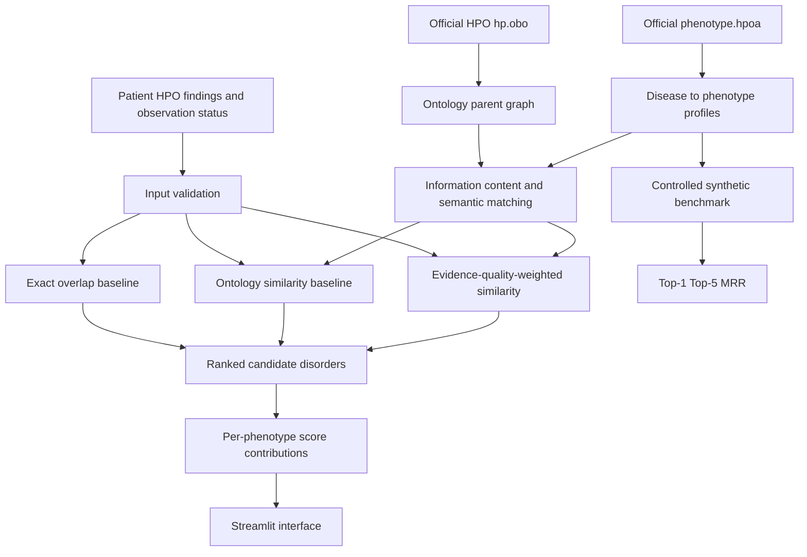

# System architecture

## Data-flow details
1. Download the official ontology and annotations and store SHA-256 checksums.
2. Parse disease associations and exclude NOT-qualified annotations from positive profiles.
3. Build a graph of HPO parent terms and compute disease-frequency information content.
4. Enter present, suspected, absent, or unknown phenotype findings.
5. Rank diseases with baseline or evidence-quality-aware scoring.
6. Show a shortlist and each finding's numeric contribution.
7. Evaluate on synthetic phenotype queries with fixed seeds and report limitations.

## Explicit non-goals
No patient-identifiable data, genetic variant analysis, clinical diagnostic certification, calibrated disease probabilities, or claim of independent patient validation.
