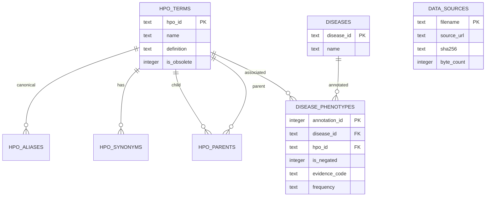

# Phase 02 — HPO / Rare Disease Local Knowledge Database

**Scope:** medical knowledge graph and disease–phenotype annotations, not a clinical patient database or diagnosis service. Runs locally on macOS Apple Silicon (M5, 16 GB), Linux or Windows with Python 3.11.

## Sources and interpretation

- HPO ontology: `https://purl.obolibrary.org/obo/hp.obo` (term IDs, names, direct is-a edges, synonyms, aliases, obsolete flags).
- HPO disease annotations: `https://purl.obolibrary.org/obo/hp/hpoa/phenotype.hpoa` (12-column tab-separated disease associations; metadata preserved where provided).
- Official HPO annotation format: https://github.com/obophenotype/human-phenotype-ontology/blob/master/docs/annotations/phenotype_hpoa.md

**Licensing:** Attribute HPO appropriately. Some OMIM-derived annotations have separate reuse terms. Do not redistribute the downloaded HPO annotations or the generated database publicly without checking source restrictions. No real patient information is requested or stored.

The Phase 1 downloader saves the original file URL, SHA-256 and size in `data/raw/manifest.json`. Each built database embeds those exact provenance fields and an import timestamp; if official data changes, the old and new hashes show that the knowledge base changed. Because the official PURLs are moving targets, a deterministic rebuild requires retaining the exact downloaded source files with the manifest in the local research environment.

## 1. Download source files locally

```bash
# Run from RareGenXAI root inside the Phase 1 virtualenv
.venv/bin/python -m src.data
.venv/bin/python scripts/doctor.py --require-data
```

The downloader uses the official sources. Do not edit third-party files to silence validation errors.

## 2. Build the local database

```bash
.venv/bin/python -m src.knowledge_db build
.venv/bin/python -m src.knowledge_db verify
.venv/bin/python -m src.knowledge_db stats
```

Default output: `data/local/raregen.sqlite3`. Rebuilding intentionally requires `--replace`; an importer error or failed integrity check does not overwrite the previous database. The loader first writes to a staging SQLite file, checks schema, foreign keys and nonempty knowledge content, then atomically renames the file.

## 3. Search and inspect

```bash
.venv/bin/python -m src.knowledge_db search-hpo "seizure"
.venv/bin/python -m src.knowledge_db search-hpo "HP:0001250"
.venv/bin/python -m src.knowledge_db search-disease "Marfan"
.venv/bin/python -m src.knowledge_db disease "MIM:154700"
```

Disease IDs must match the identifiers in the downloaded file, including its prefix. The command-line interface prints JSON. These are read-only operations with parameterized SQL. Case-insensitive name indexes speed up prefix matches. Substring and synonym searches may scan candidate rows; benchmark performance with the official dataset before making latency claims.

## 4. Schema and relationships

- `schema_migrations`: applied schema versions.
- `data_sources`: exact official URLs, SHA-256 checksums, byte lengths.
- `db_metadata`: import time, raw annotation count, unmapped HPO annotations.
- `hpo_terms`: HPO IDs, names, definitions, obsolete status.
- `hpo_aliases`: alternate IDs mapped to canonical HPO IDs.
- `hpo_synonyms`: searchable text synonyms.
- `hpo_parents`: direct `child_id -> parent_id` *is-a* relationships (not transitive closure).
- `diseases`: source-specific disease IDs and names.
- `disease_phenotypes`: disease–HPO rows with `is_negated`, evidence, reference, frequency, onset, sex and aspect.

SQLite foreign keys are enabled on writes and reads. Duplicate identical annotations collapse into one record, but distinct evidence/reference metadata is retained. The `NOT` qualifier becomes `is_negated=1` and is never turned into a positive phenotype. Unknown ontology IDs are counted; a build fails if more than 5% of input annotations are unmappable. Alternate HPO IDs resolve to canonical IDs; ambiguous aliases fail validation.


### Relationship diagram



### Reproduced import snapshot (GitHub Actions, 2026-11-18)

The dedicated full-source CI run https://github.com/uday8116/RareGenXAI/actions/runs/44237579185 downloaded the official files and successfully imported:

| Count | Records |
| --- | ---: |
| HPO terms | 20,482 |
| HPO aliases | 3,445 |
| HPO synonyms | 26,268 |
| Direct HPO is-a links | 24,436 |
| Distinct annotated diseases | 12,879 |
| Unique disease-phenotype/evidence records | 286,616 |
| Explicit negative annotation records | 733 |
| Input HPOA annotation rows | 286,649 |
| Unmapped HPO annotation rows | 0 |

These counts reflect the specific downloaded HPO/HPOA snapshot and are **not patient records**, model classification accuracy or independent clinical test data. The 33 fewer stored records compared with input rows reflect duplicate-key consolidation, rather than missing HPO IDs. A later download may produce different counts and checksums.

## 5. Read-only access for later models / FastAPI

```python
from src.db_access import connect_readonly, search_phenotypes, disease_detail, load_ranking_inputs
with connect_readonly() as conn:
    print(search_phenotypes(conn, "seizure", limit=5))
    profiles, negatives, labels, parents = load_ranking_inputs(conn)
```

The output dictionaries are compatible with the current ranking engine's disease profile and parent-set structures. ML training artifacts remain Phase 3; REST endpoints remain Phase 4. Model knowledge is not clinical ground truth.

## 6. Tests and verification

```bash
.venv/bin/python -m pytest -q tests/test_knowledge_db.py
.venv/bin/python -m pytest -q tests/test_db_integration.py
.venv/bin/python -m src.knowledge_db verify
```

Tests use synthetic fixture terms and diseases for negative / duplicate / alias / import-failure checks, plus actual official downloaded data in CI. If no local SQLite DB exists, the official-data test is marked skipped, not passed.

**Exit criteria:** Fresh import of official HPO, schema version 1, verified source hash provenance, successful foreign-key/quick checks, search lookups returning real results, and successful CI on Linux/macOS fixture jobs plus an official-dataset job. The user's own laptop still needs the local run to confirm the physical environment.
